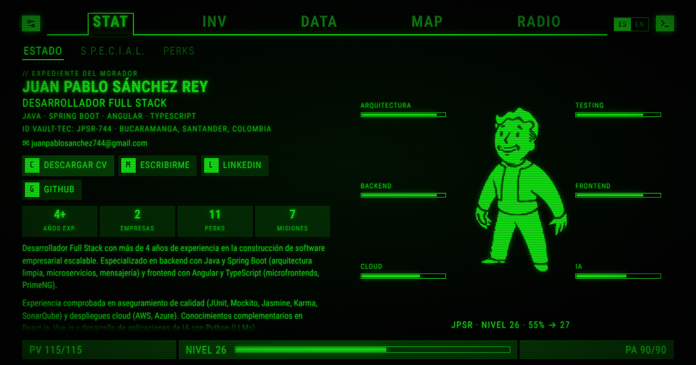

# Pip-Boy 3000 Mk IV · Juan Pablo Sánchez Rey

**🟢 En vivo: [juanpablosr.github.io/pip-boy-website](https://juanpablosr.github.io/pip-boy-website/)**

Este es mi sitio personal: mi hoja de vida y mi trayectoria como **Desarrollador Full Stack**
(Java · Spring Boot · Angular · TypeScript), presentadas dentro de un Pip-Boy de **Fallout 4**
con guiños a Fallout 3 y New Vegas. Quería que mi presencia en línea tuviera algo de mí,
no solo una página más con un CV.



¿Prefieres lo clásico? En el sitio, el botón **Descargar CV** genera mi hoja de vida en PDF,
y también está mi [LinkedIn](https://www.linkedin.com/in/juan-pablo-sanchez-rey).

## Qué hay dentro

| Pestaña | Contenido |
| --- | --- |
| **STAT** | *Estado* (ficha, perfil, CTA para descargar el CV), *S.P.E.C.I.A.L.* (cada atributo mapeado a una habilidad real) y *Perks* |
| **INV** | Stack técnico como inventario: *Armas* (lenguajes/frameworks), *Ropa* (testing y calidad), *Ayuda* (metodologías), *Varios* (cloud/DevOps/IDEs), *Holo* (terminal, minijuego, CV) y *Munición* (bases de datos y mensajería) |
| **DATA** | *Misiones* (experiencia laboral y formación con objetivos y logros), *Talleres* (proyectos) y *Estadísticas* |
| **MAP** | Mapa local (Santander) y del mundo (Colombia) con datos geográficos reales, contacto y hora local |
| **RADIO** | Las emisoras del juego del tema elegido: Diamond City Radio y Classical Radio (Fallout 4, también con Vault-Tec y Mk VI), Galaxy News Radio y Enclave Radio (Fallout 3) o Radio New Vegas y Mojave Music Radio (New Vegas). La *Señal de socorro* en código Morse, generada en tiempo real, suena con todos |

Extras:

- Pantalla de encendido + arranque real de **PIP-OS V7.1.0.8** (se salta con cualquier tecla; solo aparece una vez por sesión).
- **Terminal RobCo** (tecla `~` / `º` o el botón `>_`) con comandos: `ayuda`, `experiencia`, `skills`, `contacto`, `cv`, `tema nv`, `idioma en`, `radio`, `hack`…
- **Minijuego de hackeo** de terminales, con recompensa.
- **CV en PDF** (español e inglés) que se descarga directo desde *Descargar CV*, generado a partir de los mismos datos; también se puede imprimir desde ⚙.
- **Bilingüe** (ES / EN, detecta el idioma del navegador).
- **Colores de pantalla**: Fallout 4, Fallout 3, New Vegas (ámbar), Vault-Tec (azul) y Mk VI (blanco).
- Efectos CRT, sonidos sintetizados con Web Audio (se pueden apagar en ⚙), `prefers-reduced-motion` respetado.
- Totalmente navegable con teclado y usable en móvil.
- SEO: JSON-LD (`schema.org/Person`), Open Graph, y el CV completo en `<noscript>` para buscadores.

### Controles

| Tecla | Acción |
| --- | --- |
| `Q` / `E` · `1`–`5` | Cambiar pestaña |
| `A` / `D` · `←` / `→` | Cambiar sub-pestaña |
| `W` / `S` · `↑` / `↓` | Moverse en la lista |
| `Enter` | Usar holocinta / sintonizar estación |
| `C` · `M` · `L` · `G` | En *Estado*: descargar CV, escribirme, LinkedIn, GitHub |
| `~` · `º` | Abrir terminal · `Esc` cierra |
| `Esc` | Abrir el menú (color, idioma, sonido…) cuando no hay nada abierto; si hay algo abierto, lo cierra |

## Cómo está organizado el contenido

Todo el contenido vive en **`src/data/`**, separado de la interfaz:

- `profile.es.ts` y `profile.en.ts`: perfil, SPECIAL, perks, inventario, misiones, proyectos, radio…
  Ambos cumplen la interfaz de `types.ts`, así que TypeScript avisa si una traducción queda incompleta.
- `shared.ts`: correo, LinkedIn, GitHub y las emisoras de radio (comunes a ambos idiomas). Cada emisora apunta a un ítem de archive.org; el navegador lee su lista de canciones de la API pública de metadatos y, si no puede, usa las pistas conocidas que tenga.
- Los textos de la interfaz están en `src/i18n/ui.ts`.

El nivel del Pip-Boy se calcula solo a partir de `careerStart` (sube con el tiempo).

Después de editar el contenido regenero los PDF del CV (`public/cv/`) con:

```bash
npm run dev          # en otra terminal
npm run cv:pdf       # requiere Playwright: npm i -D playwright && npx playwright install chromium
```

## Animaciones de Vault Boy

Las animaciones están en `src/assets/vaultboy/` como PNG animados **blancos sobre transparente**;
el sitio los colorea con el color de pantalla activo. Se cargan por nombre, y si falta alguno se usa uno por defecto:

| Archivo | Dónde aparece |
| --- | --- |
| `boot.png` | Splash de arranque |
| `status.png` | STAT › Estado |
| `special-s.png` … `special-l.png` | STAT › S.P.E.C.I.A.L. (uno por letra) |
| `perk-<id>.png` | STAT › Perks (ids en `profile.es.ts`) |
| `stats.png` | DATA › Estadísticas |
| `map.png` | MAP |

### Usar las animaciones originales de Fallout 4

Las animaciones originales del Pip-Boy son propiedad de Bethesda y vienen dentro de los archivos del juego,
así que no las incluyo en el repositorio. Con una copia del juego se pueden extraer así:

1. Abre `Fallout 4/Data/Fallout4 - Interface.ba2` con **BAE** (Bethesda Archive Extractor) o **Archive2** (Creation Kit) y extrae la carpeta `Interface/`.
2. Abre con **JPEXS Free Flash Decompiler** los `.swf` de la carpeta `Interface/` que contienen las animaciones de Vault Boy (el menú del Pip-Boy es `PipboyMenu.swf`; las ilustraciones de SPECIAL y perks están en sus propios `.swf`).
3. Exporta el sprite/clip de la animación que quieras como **PNG (secuencia de frames)** o **GIF**, con fondo transparente.
4. Conviértelo al formato del sitio:

   ```bash
   pip install pillow numpy
   python3 scripts/vaultboy_import.py ruta/a/los_frames special-s
   python3 scripts/vaultboy_import.py ruta/a/animacion.gif status
   ```

   El script detecta el tipo de fondo (`--mode alpha|dark|chroma` para forzarlo), recorta, escala y guarda en `src/assets/vaultboy/`.

## Desarrollo

```bash
npm install
npm run dev       # http://localhost:5173
npm run lint
npm run build     # genera dist/
npm run preview
```

### Despliegue

El sitio está publicado en **GitHub Pages**. El workflow `.github/workflows/deploy.yml` compila el proyecto
en cada push a `main` y publica `dist/` en la rama `gh-pages`. Los pull requests pasan por lint y build (`ci.yml`).

El build usa rutas relativas (`base: './'`), así que `dist/` también funciona en la raíz de cualquier dominio
(Netlify, Vercel, Cloudflare Pages…). Para compilar localmente con URLs absolutas en las vistas previas sociales:

```bash
cp .env.example .env   # y edita VITE_SITE_URL
```

La imagen de vista previa es `public/og-image.png` (1200×630).

## Video promocional

En [`promo/`](promo/) está el video de ~48 s en motion graphics que usé para presentar el sitio,
en horizontal (16:9), para el feed de LinkedIn (4:5) y para Reels (9:16). Es una composición HTML
determinista renderizada cuadro a cuadro con una banda sonora sintetizada por código, y ahí también
está el texto de las publicaciones. Las instrucciones para regenerarlo están en [`promo/README.md`](promo/README.md).

## Stack

React 19 · TypeScript · Vite · Framer Motion · d3-geo · Web Audio API · lucide-react.

---

*Fallout, Pip-Boy, Vault Boy, Vault-Tec y RobCo son marcas de Bethesda Softworks / ZeniMax Media.
Este es un proyecto personal, sin fines comerciales, hecho por un fan de la saga.*

Contacto: [juanpablosanchez744@gmail.com](mailto:juanpablosanchez744@gmail.com) · [LinkedIn](https://www.linkedin.com/in/juan-pablo-sanchez-rey)
